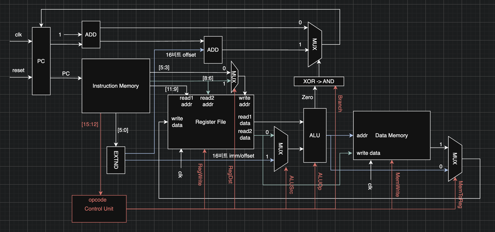

<div align="center">

# mini-cpu

**Verilog로 설계한 16비트 단일 사이클(single-cycle) CPU**

9개의 명령어 · 8개의 범용 레지스터 · 자체 어셈블러


</div>

---

## 목차

1. [개요](#개요)
2. [아키텍처](#아키텍처)
3. [명령어 집합 (ISA)](#명령어-집합-isa)
4. [제어 신호](#제어-신호)
5. [모듈 구성](#모듈-구성)
6. [디렉터리 구조](#디렉터리-구조)
7. [시작하기](#시작하기)
8. [어셈블러](#어셈블러)
9. [테스트 프로그램](#테스트-프로그램)
10. [설계 노트](#설계-노트)
11. [개발 과정](#개발-과정)

---

## 개요

**mini-cpu**는 MIPS 스타일의 단일 사이클 데이터패스를 바탕으로, 16비트 명령어 체계를 직접 정의하고 Verilog로 구현한 교육용 CPU다. 명령어 하나가 한 클럭 사이클 안에 인출(fetch)부터 쓰기(write-back)까지 모두 완료된다.

| 항목 | 사양 |
| --- | --- |
| 데이터 / 명령어 폭 | 16비트 |
| 범용 레지스터 | 8개 (`r0` ~ `r7`), `r0`는 항상 0 |
| 명령어 메모리 | 64워드 (워드 단위 주소) |
| 데이터 메모리 | 64워드 (워드 단위 주소) |
| 명령어 수 | 9개 (산술·논리 4, 즉시값 1, 메모리 2, 분기 2) |
| 즉시값 / 오프셋 | 6비트, 부호 확장 (−32 ~ +31) |
| 실행 방식 | 단일 사이클, 상승 에지(posedge) 동기 |

---

## 아키텍처

<p align="center">
  
</p>

명령어 한 개가 처리되는 흐름은 다음과 같다.

1. **Fetch** — `PC`가 가리키는 주소의 명령어를 `Instruction Memory`에서 읽는다.
2. **Decode** — 상위 4비트 `[15:12]`가 `Control Unit`으로 들어가 제어 신호를 만든다. 하위 6비트 `[5:0]`은 `EXTND`(부호 확장기)를 거쳐 16비트가 된다.
3. **Register Read** — `[11:9]`, `[8:6]`이 가리키는 두 레지스터 값을 동시에 읽는다.
4. **Execute** — `ALUSrc`에 따라 두 번째 피연산자(레지스터 값 또는 즉시값)를 고르고, `ALUOp`에 따라 연산한다.
5. **Memory** — `LOAD`/`STORE`는 ALU 결과를 주소로 `Data Memory`에 접근한다.
6. **Write-back** — `MemToReg`에 따라 ALU 결과 또는 메모리 값을 레지스터에 쓴다. 목적지는 `RegDst`가 결정한다.
7. **Next PC** — 분기 조건이 성립하면 `PC + 1 + offset`, 아니면 `PC + 1`이 다음 PC가 된다.

> [!NOTE]
> 다이어그램의 색상은 신호 종류를 구분한다. **빨간색**은 Control Unit이 내보내는 제어 신호, **파란색**은 부호 확장된 즉시값/오프셋과 ALU 결과, **초록색**은 `read2 data` 경로를 나타낸다.

---

## 명령어 집합 (ISA)

### 명령어 형식

모든 명령어는 16비트이며, 상위 4비트가 opcode다. 피연산자 배치에 따라 두 가지 형식으로 나뉜다.

```
R-type   │ 15    12 │ 11   9 │ 8    6 │ 5    3 │ 2    0 │
         │  opcode  │  rs1   │  rs2   │   rd   │  000   │

I-type   │ 15    12 │ 11   9 │ 8    6 │ 5               0 │
         │  opcode  │  rs1   │ rd/rs2 │    imm / offset   │
```

### 명령어 목록

| 명령어 | opcode | 형식 | 어셈블리 | 동작 |
| --- | :---: | :---: | --- | --- |
| `ADD`  | `0000` | R | `ADD rs1 rs2 rd`      | `rd ← rs1 + rs2` |
| `SUB`  | `0001` | R | `SUB rs1 rs2 rd`      | `rd ← rs1 − rs2` |
| `AND`  | `0010` | R | `AND rs1 rs2 rd`      | `rd ← rs1 & rs2` |
| `OR`   | `0011` | R | `OR rs1 rs2 rd`       | `rd ← rs1 \| rs2` |
| `ADDI` | `0100` | I | `ADDI rs1 rd imm`     | `rd ← rs1 + sext(imm)` |
| `LOAD` | `0101` | I | `LD rs1 rd imm`       | `rd ← MEM[rs1 + sext(imm)]` |
| `STORE`| `0110` | I | `ST rs1 rs2 imm`      | `MEM[rs1 + sext(imm)] ← rs2` |
| `BEQ`  | `0111` | I | `BEQ rs1 rs2 offset`  | `if (rs1 == rs2) PC ← PC + 1 + sext(offset)` |
| `BNE`  | `1000` | I | `BNE rs1 rs2 offset`  | `if (rs1 ≠ rs2) PC ← PC + 1 + sext(offset)` |

> [!TIP]
> 어셈블리의 피연산자 순서는 **비트 필드 순서**를 그대로 따른다. 즉 `ADD r1 r2 r3`은 `r3 ← r1 + r2`이며, 목적지 레지스터가 마지막에 온다.

### 인코딩 예시

```
ADDI r0 r1 4      →  0100_000_001_000100     r1 ← r0 + 4
ADD  r1 r2 r3     →  0000_001_010_011_000    r3 ← r1 + r2
BNE  r1 r3 -3     →  1000_001_011_111101     r1 ≠ r3 이면 PC ← PC + 1 − 3
```

명령어 비트 필드에 대한 원본 정의는 [`docs/isa.md`](docs/isa.md)에 있다.

---

## 제어 신호

`Control Unit`은 opcode만 보고 7종의 제어 신호를 조합 논리로 생성한다.

| opcode | 명령어 | RegDst | RegWrite | ALUSrc | ALUOp | Branch | MemWrite | MemToReg |
| :---: | --- | :---: | :---: | :---: | :---: | :---: | :---: | :---: |
| `0000` | ADD   | 0 | 1 | 0 | add (`00`) | `00` | 0 | 0 |
| `0001` | SUB   | 0 | 1 | 0 | sub (`01`) | `00` | 0 | 0 |
| `0010` | AND   | 0 | 1 | 0 | and (`10`) | `00` | 0 | 0 |
| `0011` | OR    | 0 | 1 | 0 | or (`11`)  | `00` | 0 | 0 |
| `0100` | ADDI  | 1 | 1 | 1 | add (`00`) | `00` | 0 | 0 |
| `0101` | LOAD  | 1 | 1 | 1 | add (`00`) | `00` | 0 | 1 |
| `0110` | STORE | 1 | 0 | 1 | add (`00`) | `00` | 1 | 0 |
| `0111` | BEQ   | 1 | 0 | 0 | sub (`01`) | `10` | 0 | 0 |
| `1000` | BNE   | 1 | 0 | 0 | sub (`01`) | `11` | 0 | 0 |

<details>
<summary><b>각 신호의 의미</b></summary>

<br>

| 신호 | 폭 | `0`일 때 | `1`일 때 |
| --- | :---: | --- | --- |
| `RegDst`   | 1 | 쓰기 레지스터 = `[5:3]` | 쓰기 레지스터 = `[8:6]` |
| `RegWrite` | 1 | 레지스터 쓰기 안 함 | 레지스터 쓰기 |
| `ALUSrc`   | 1 | ALU 두 번째 입력 = `read2 data` | ALU 두 번째 입력 = 부호 확장된 즉시값 |
| `MemWrite` | 1 | 메모리 쓰기 안 함 | 메모리 쓰기 |
| `MemToReg` | 1 | 레지스터에 ALU 결과 기록 | 레지스터에 메모리 값 기록 |
| `ALUOp`    | 2 | `00` add · `01` sub · `10` and · `11` or | |
| `Branch`   | 2 | `0x` 분기 없음 · `10` BEQ · `11` BNE | |

정의되지 않은 opcode(`1001` ~ `1111`)는 `RegWrite = 0`으로 처리되어 상태를 바꾸지 않는다.

</details>

### 분기 판정

분기는 별도 비교기 없이 ALU의 `zero` 플래그와 `Branch` 신호 2비트만으로 판정한다.

```verilog
assign PCSrc = (Branch[0] ^ zero) && Branch[1];
```

| Branch | zero | PCSrc | 의미 |
| :---: | :---: | :---: | --- |
| `0x` | – | 0 | 분기 명령어가 아님 |
| `10` | 1 | **1** | BEQ, `rs1 == rs2` → 분기 |
| `10` | 0 | 0 | BEQ, 조건 불만족 |
| `11` | 0 | **1** | BNE, `rs1 ≠ rs2` → 분기 |
| `11` | 1 | 0 | BNE, 조건 불만족 |

`Branch[1]`은 "분기 명령어인가", `Branch[0]`은 "`zero`를 반전해서 볼 것인가"를 뜻한다.

---

## 모듈 구성

| 모듈 | 파일 | 종류 | 역할 |
| --- | --- | :---: | --- |
| `cpu`     | [`src/cpu.v`](src/cpu.v)         | Top     | 모든 모듈을 연결하는 최상위 데이터패스 |
| `pc`      | [`src/pc.v`](src/pc.v)           | 순차    | 프로그램 카운터. posedge에 `next_pc` 저장, 동기식 `reset` |
| `imem`    | [`src/imem.v`](src/imem.v)       | 조합    | 64워드 명령어 메모리. 시뮬레이션 시작 시 `$readmemb`로 프로그램 적재 |
| `control` | [`src/control.v`](src/control.v) | 조합    | opcode → 제어 신호 디코더 |
| `regfile` | [`src/regfile.v`](src/regfile.v) | 혼합    | 2-읽기 / 1-쓰기 레지스터 파일. 읽기는 비동기, 쓰기는 posedge |
| `sext`    | [`src/sext.v`](src/sext.v)       | 조합    | 6비트 → 16비트 부호 확장 |
| `alu`     | [`src/alu.v`](src/alu.v)         | 조합    | ADD / SUB / AND / OR 연산 및 `zero` 플래그 출력 |
| `dmem`    | [`src/dmem.v`](src/dmem.v)       | 혼합    | 64워드 데이터 메모리. 읽기는 비동기, 쓰기는 posedge |
| `adder`   | [`src/adder.v`](src/adder.v)     | 조합    | 4비트 덧셈기. 툴체인 동작 확인용 예제 (CPU에서는 사용하지 않음) |

`cpu` 모듈은 디버깅을 위해 내부 신호 일부를 포트로 노출한다.

```verilog
module cpu(
    input         clk,
    input         reset,
    output [15:0] pc,         // 현재 PC
    output [15:0] instr,      // 현재 명령어
    output        RegWrite,   // 레지스터 쓰기 여부
    output [15:0] load_data,  // 데이터 메모리 읽기 값
    output [15:0] ALU_res     // ALU 결과
);
```

---

## 디렉터리 구조

```
mini-cpu/
├── src/                    # CPU를 구성하는 Verilog 모듈
│   ├── cpu.v               #   최상위 모듈 (데이터패스)
│   ├── pc.v  imem.v  control.v  regfile.v
│   ├── sext.v  alu.v  dmem.v
│   └── adder.v             #   툴체인 확인용 예제
├── tb/                     # 테스트벤치
│   ├── *_tb.v              #   모듈 단위 테스트
│   └── test{1..4}_tb.v     #   프로그램 단위 통합 테스트
├── programs/               # 어셈블리 소스 (.asm)
├── tools/
│   └── assembler.py        # .asm → 기계어(.txt) 어셈블러
├── docs/
│   ├── isa.md              # 명령어 집합 정의
│   ├── control.md          # 제어 신호 표
│   ├── datapath_final.png  # 데이터패스 다이어그램
│   └── test*.txt           # 기계어 프로그램 (imem 적재용)
└── build/                  # 시뮬레이션 산출물 (git 추적 제외)
```

---

## 시작하기

### 요구 사항

- [Icarus Verilog](https://steveicarus.github.io/iverilog/) — `iverilog`, `vvp`
- Python **3.10 이상** — 어셈블러가 `match` 문을 사용한다
- (선택) [GTKWave](https://gtkwave.sourceforge.net/) — 파형 확인용

```bash
# macOS
brew install icarus-verilog

# Ubuntu / Debian
sudo apt install iverilog
```

### 시뮬레이션 실행

> [!IMPORTANT]
> `imem.v`는 프로그램 파일을 상대 경로(`docs/...`)로 읽는다. 모든 명령은 **저장소 루트에서** 실행해야 한다.

```bash
mkdir -p build

# 통합 테스트 (기본 적재 프로그램: test4_maxnum)
iverilog -o build/test4_tb tb/test4_tb.v src/*.v
vvp build/test4_tb
```

실행이 끝나면 매 사이클의 상태와 최종 결과가 출력된다.

```
time = 15, pc = 0, instr = 0100000110000100, RegWrite = 1, Memory Load Data = x, ALU Result = 4
...
MAX Number = 9
```

프로그램이 64줄보다 짧으면 `$readmemb ... Not enough words in the file` 경고가 함께 출력된다. 남는 메모리 칸이 비어 있다는 뜻이며 실행 결과에는 영향이 없다.

### 모듈 단위 테스트

각 모듈은 독립된 테스트벤치로 따로 검증할 수 있다.

```bash
iverilog -o build/alu_tb     tb/alu_tb.v     src/alu.v     && vvp build/alu_tb
iverilog -o build/control_tb tb/control_tb.v src/control.v && vvp build/control_tb
iverilog -o build/regfile_tb tb/regfile_tb.v src/regfile.v && vvp build/regfile_tb
```

### 실행할 프로그램 바꾸기

명령어 메모리에 적재되는 프로그램은 [`src/imem.v`](src/imem.v)에서 지정한다. 다른 프로그램을 돌리려면 경로를 바꾼 뒤 해당 테스트벤치를 실행한다.

```verilog
initial begin
    $readmemb("docs/test4_maxnum.txt", instr);   // ← 이 경로를 변경
end
```

---

## 어셈블러

[`tools/assembler.py`](tools/assembler.py)는 사람이 읽을 수 있는 어셈블리를 `$readmemb`가 읽을 수 있는 2진 텍스트로 변환한다.

```bash
python3 tools/assembler.py <입력.asm> <출력.txt>

# 예시
python3 tools/assembler.py programs/test4_maxnum.asm docs/test4_maxnum.txt
```

**문법 규칙**

- 한 줄에 명령어 하나, 피연산자는 공백으로 구분한다.
- 레지스터는 `r0` ~ `r7`로 쓴다.
- 즉시값/오프셋은 10진수로 쓰며 음수를 지원한다. 하위 6비트로 잘려 인코딩된다.
- 빈 줄은 무시되므로 코드 블록을 나누는 데 쓸 수 있다.
- 메모리 명령어의 니모닉은 `LD`, `ST`다.

**입력 → 출력**

<table>
<tr><th>programs/test1_Rtype.asm</th><th>docs/test1_Rtype.txt</th></tr>
<tr>
<td>

```asm
ADDI r0 r1 4
ADDI r0 r2 -2
ADD r1 r2 r3

SUB r1 r2 r4
AND r1 r2 r5
OR r1 r2 r6
```

</td>
<td>

```
0100_000_001_000100
0100_000_010_111110
0000_001_010_011000

0001_001_010_100000
0010_001_010_101000
0011_001_010_110000
```

</td>
</tr>
</table>

> [!NOTE]
> 현재 어셈블러는 주석과 레이블을 지원하지 않는다. 분기 오프셋은 `다음 명령어 주소` 기준의 상대값으로 직접 계산해서 적어야 한다.

---

## 테스트 프로그램

네 개의 통합 테스트로 명령어 전체를 단계적으로 검증한다. 아래 결과는 모두 Icarus Verilog 시뮬레이션으로 확인한 값이다.

| # | 프로그램 | 검증 대상 | 결과 |
| :---: | --- | --- | --- |
| 1 | [`test1_Rtype`](docs/test1_Rtype.txt)       | `ADD` `SUB` `AND` `OR` `ADDI` | `r3=2` `r4=6` `r5=4` `r6=-2` |
| 2 | [`test2_sum`](docs/test2_sum.txt)           | 반복문 (`BNE`)                | `1 + 2 + … + 10 = 55` |
| 3 | [`test3_multiply`](docs/test3_multiply.txt) | 덧셈 반복을 이용한 곱셈        | `5 × 7 = 35` |
| 4 | [`test4_maxnum`](programs/test4_maxnum.asm) | `LD` `ST` `BEQ` `BNE` 종합     | `max(4, 9, 2, 7, 5) = 9` |

<details>
<summary><b>Test 1 — R-type 연산</b></summary>

<br>

`r1 = 4`, `r2 = -2`를 넣고 네 가지 R-type 연산을 수행한다.

```asm
ADDI r0 r1 4        ; r1 = 4
ADDI r0 r2 -2       ; r2 = -2 (0xFFFE)
ADD  r1 r2 r3       ; r3 = 4 + (-2)   = 2
SUB  r1 r2 r4       ; r4 = 4 - (-2)   = 6
AND  r1 r2 r5       ; r5 = 0x0004 & 0xFFFE = 4
OR   r1 r2 r6       ; r6 = 0x0004 | 0xFFFE = 0xFFFE (-2)
```

</details>

<details>
<summary><b>Test 2 — 1부터 10까지의 합</b></summary>

<br>

```asm
ADD  r0 r0 r1       ; i   = 0
ADD  r0 r0 r2       ; sum = 0
ADDI r0 r3 10       ; n   = 10
                    ; loop:
ADDI r1 r1 1        ;   i   = i + 1
ADD  r1 r2 r2       ;   sum = sum + i
BNE  r1 r3 -3       ;   if (i != n) goto loop
```

결과는 `r2`에 저장된다 → **55**

</details>

<details>
<summary><b>Test 3 — 곱셈 (5 × 7)</b></summary>

<br>

곱셈 명령어가 없으므로 덧셈을 반복해서 구현한다.

```asm
ADDI r0 r1 5        ; a   = 5
ADDI r0 r2 7        ; b   = 7
ADD  r0 r0 r3       ; cnt = 0
ADD  r0 r0 r4       ; acc = 0
                    ; loop:
ADDI r3 r3 1        ;   cnt = cnt + 1
ADD  r2 r4 r4       ;   acc = acc + b
BNE  r1 r3 -3       ;   if (cnt != a) goto loop
```

결과는 `r4`에 저장된다 → **35**

</details>

<details>
<summary><b>Test 4 — 배열의 최댓값</b></summary>

<br>

데이터 메모리 `MEM[10..14]`에 `4, 9, 2, 7, 5`를 저장한 뒤 최댓값을 찾는다. 비교 명령어(`SLT` 등)가 없으므로 **`a − b`의 부호 비트**로 대소를 판정한다.

```asm
; 1) 배열 초기화: MEM[10..14] = {4, 9, 2, 7, 5}
ADDI r0 r6 4
ST   r0 r6 10
...
ADDI r0 r6 5
ST   r0 r6 14

; 2) 부호 비트 마스크 생성: r1 = 16 << 11 = 0x8000
ADDI r0 r1 16
ADDI r0 r2 11
ADD  r1 r1 r1       ; r1 = r1 * 2
ADDI r2 r2 -1
BNE  r2 r0 -3

; 3) 최댓값 탐색 (뒤에서부터 순회)
ADD  r0 r0 r3       ; max = 0
ADD  r0 r0 r4       ; cur = 0
ADDI r0 r5 5        ; idx = 5
ADDI r5 r5 -1       ; loop: idx = idx - 1
LD   r5 r4 10       ;   cur  = MEM[idx + 10]
SUB  r3 r4 r7       ;   diff = max - cur
AND  r1 r7 r6       ;   sign = diff & 0x8000
BEQ  r6 r0 1        ;   if (max >= cur) skip
ADD  r4 r0 r3       ;   max = cur
BNE  r5 r0 -7       ;   if (idx != 0) goto loop
```

결과는 `r3`에 저장된다 → **9**

</details>

---

## 설계 노트

**`r0` 하드와이어드 제로**
레지스터 파일은 `r0`에 대한 쓰기를 무시하고, `r0`를 읽으면 항상 `0`을 돌려준다. 덕분에 `ADD r0 r0 rd`로 레지스터를 초기화하고, `ADDI r0 rd imm`으로 상수를 적재할 수 있다.

**PC 상대 분기**
분기 목적지는 `PC + 1 + sext(offset)`이다. 6비트 오프셋으로 다음 명령어 기준 −32 ~ +31 범위를 이동할 수 있다.

**워드 단위 주소**
명령어 메모리와 데이터 메모리 모두 1 주소 = 16비트 1워드다. 명령어 메모리는 `pc[5:0]`만 사용해 64개의 명령어를 구분한다.

**비동기 읽기, 동기 쓰기**
레지스터 파일과 데이터 메모리는 읽기를 조합 논리로, 쓰기를 클럭 상승 에지에서 수행한다. 따라서 한 사이클 안에 읽기 → 연산 → 쓰기가 완결된다.

**알려진 제약**
- 프로그램은 최대 64개의 명령어, 데이터는 최대 64워드까지만 다룰 수 있다.
- 정지(HALT) 명령어가 없으므로 테스트벤치가 정해진 사이클 수만큼만 실행한다.
- 데이터 메모리는 초기화되지 않으므로, 쓰기 전에 읽으면 `x`가 나온다.

---

## 개발 과정

설계 문서 → 개별 모듈 → 단계적 조립 → 프로그램 검증 → 도구 순으로 진행했다.

| 단계 | 내용 |
| --- | --- |
| **1. 설계** | ISA 표 작성 → 데이터패스 다이어그램 → 제어 신호 표 확정 |
| **2. 모듈 구현** | `alu` → `regfile` → `pc` → `imem` → `sext` → `dmem` → `control` |
| **3. CPU 조립** | 1·2차 R-type & `ADDI` → 3차 `LOAD` & `STORE` → 4차 `BEQ` & `BNE` |
| **4. 검증** | 테스트 프로그램 1 ~ 4 작성 및 시뮬레이션 |
| **5. 도구** | Python 어셈블러 작성, 빈 줄 처리 지원 |
